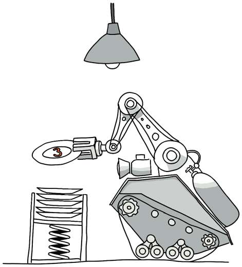

# Ex Machinis Player's Manual

_Converted from the September 2020 edition and updated for the current game. Every example in this manual has been run against the game._

> **Keep this manual current.** It is the player-facing description of the game. When a change to the code or the game data (see the [design manual](design-manual.md)) changes something a player sees, update this manual in the same pull request.

**Changes since the September 2020 edition:**
- [Chapter 4](#chapter-4-issuing-commands) starts with unpacking your kit: a Mining Kit (engine, mining and refining modules) or a Factory Kit (engine and the tools that make things), chosen at release. Travel uses protocol 5001 (your engine) instead of 5.
- The mining example uses kunspar on the Moon, which the Mining Kit's Worm can mine. A [table](#extracting-minerals) shows which module mines which minerals, including on the new asteroids, comets and planetary rings.
- [Chapter 6](#chapter-6-going-to-market) uses the correct sell protocol (7, not 9) and a resource that exists (kunspar, 1100).
- [Chapter 7](#chapter-7-stringing-variables) fixes the argument order of the array examples (`10 box !`, not `box 10 !`) and the cell size (two bytes).
- [Chapter 8](#chapter-8-asking-questions) uses the current query numbers.
- [Chapter 9](#chapter-9-making-decisions) shows the outputs the game really gives.

Thank you for your support!

## Table of Contents

- [Chapter 1: Getting Started](#chapter-1-getting-started)
  - [Your fortune awaits!](#your-fortune-awaits)
  - [Every company is an experiment](#every-company-is-an-experiment)
  - [Releasing a script (Public Forge)](#releasing-a-script-public-forge)
  - [What your drone says](#what-your-drone-says)
  - [About the examples in this manual](#about-the-examples-in-this-manual)
- [Chapter 2: Stacking Numbers](#chapter-2-stacking-numbers)
  - [Doing Simple Math](#doing-simple-math)
  - [Managing the stack](#managing-the-stack)
  - [Big numbers: double cells](#big-numbers-double-cells)
- [Chapter 3: Working with Resources](#chapter-3-working-with-resources)
  - [Distinguishing resource sizes and technology levels](#distinguishing-resource-sizes-and-technology-levels)
  - [Organizing resources by Resource ID](#organizing-resources-by-resource-id)
  - [Browsing the Resource Catalog](#browsing-the-resource-catalog)
- [Chapter 4: Issuing Commands](#chapter-4-issuing-commands)
  - [Unpacking your kit](#unpacking-your-kit)
  - [Fuel](#fuel)
  - [Wrecks and plunder](#wrecks-and-plunder)
  - [Taxes](#taxes)
  - [Waiting](#waiting)
  - [Traveling between locations](#traveling-between-locations)
  - [Time and distance](#time-and-distance)
  - [Understanding how protocols are organized and numbered](#understanding-how-protocols-are-organized-and-numbered)
  - [Extracting minerals](#extracting-minerals)
  - [Reprocessing minerals](#reprocessing-minerals)
  - [Synthesizing complex materials](#synthesizing-complex-materials)
  - [Producing more complex spacecraft components](#producing-more-complex-spacecraft-components)
  - [Launching new spacecraft](#launching-new-spacecraft)
- [Chapter 5: Building A Vocabulary](#chapter-5-building-a-vocabulary)
  - [Creating your own words](#creating-your-own-words)
  - [Commenting on your code](#commenting-on-your-code)
  - [Sending greetings](#sending-greetings)
  - [Broadcasting to other drones](#broadcasting-to-other-drones)
- [Chapter 6: Going to Market](#chapter-6-going-to-market)
  - [Placing and adjusting market orders](#placing-and-adjusting-market-orders)
  - [Trading at the exchanges](#trading-at-the-exchanges)
  - [Transferring resources between drones](#transferring-resources-between-drones)
- [Chapter 7: Stringing Variables](#chapter-7-stringing-variables)
  - [Using variables when programming your drones](#using-variables-when-programming-your-drones)
  - [What's really happening with variables?](#whats-really-happening-with-variables)
  - [Creating and Accessing Arrays](#creating-and-accessing-arrays)
  - [Working with strings](#working-with-strings)
  - [Different ways to command your spacecraft](#different-ways-to-command-your-spacecraft)
- [Chapter 8: Asking Questions](#chapter-8-asking-questions)
- [Chapter 9: Making Decisions](#chapter-9-making-decisions)
  - [Finding the truth in numbers](#finding-the-truth-in-numbers)
  - [Experimenting with logical operators](#experimenting-with-logical-operators)
  - [Repeating yourself: loops](#repeating-yourself-loops)
  - [Market-aware drones](#market-aware-drones)
- [Appendix A: FORTH Error Codes](#appendix-a-forth-error-codes)

## Chapter 1: Getting Started

### Your fortune awaits!

Ex Machinis is a multiplayer space game, which takes place in a parallel universe. Within this altered reality, space technologies have rapidly advanced since the 1950's to the point where extensive interplanetary industries exist to produce materials that drive the human economy back on Earth. The vast majority of these spacecraft are unmanned vehicles, which are assembled in space and are controlled by terrestrial barons.

As part of the international agreement that drove the colonization of space at the end of the second world war, citizens of the signatory nations are guaranteed access to basic spacecraft which can be used to build profitable businesses. This democratization of space has been the biggest driver behind the rapid growth of extraterrestrial industries and technologies.

It is your birthright to take control of your own remotely piloted spacecraft and build a thriving stellar industry. But this can only be accomplished by programming your spacecraft to efficiently mine, manufacture, and trade materials on the interplanetary economy.

### Every company is an experiment

Once you release a drone, it runs on its own: you can't steer it, and nobody will rescue it. Sooner or later every company meets something its program didn't foresee (a market that moves, a deposit that runs dry, a rival that undercuts it, a bug) and dies. That is how the game is meant to be played. Treat each company as an experiment:

- **Release, watch, learn.** Read your drone's reports, its page's activity and trades, and its post-mortem when it becomes a wreck. Each one tells you something about your program or the market.
- **Iterate.** Fix the flaw, try a different idea, and release the next version as a new company. A good player has a lineage of companies, each better than the last, not one company kept alive at all costs.
- **Expect the unexpected.** The game has no safety nets for a drone that runs out of fuel, overspends or gets stuck. If a drone should survive something, its program must handle it, or the market must: other players' drones buy, sell and deliver whatever pays (see [Running low on fuel](#running-low-on-fuel)).
- **Use the Test button** to try a script in a test world first, and the Machine page to check a word against live data. They are cheap; a released company is the real experiment.

### Releasing a script (Public Forge)

There is no email, and no account to open: anyone can write a drone's program on the **Release** page and release it:

- each release starts a new company, with one drone in orbit around Earth, the kit you choose (a Mining Kit or a Factory Kit; see [Unpacking your kit](#unpacking-your-kit)), 100 fuel and 1,000 credits;
- the drone loads your script, then runs your word `launched` on its own, so your script should define words and end with `: launched ... ;`;
- you go to the drone's page, which shows everything it does and what it prints (once its signal has reached Earth). It's public, like the drone's code: keep its link to follow it;
- if `launched` crashes, the drone restarts it from the script you released (see [When `launched` crashes](#when-launched-crashes)).

A released drone can't be sent new commands from the Release page, so test your script before you release it. The **Test** button (when the test world is running) does that:

- your script runs in the test world, a separate copy of the game with the same rules, data and starting company, and a clock that runs ten times faster;
- you go to the test run's own page, which shows what the test drone prints, its latest events (what it did, its cargo and credits), its trades and any crashes: keep its link to come back to it;
- nothing in the test world affects the live one, and you can test as often as you like (the latest hundred test runs are kept);
- the test world has its own market, so trades there are only with other test runs.

Both the Test button and a release warn you if your script redefines a word your drone already knows, such as `report`, `load` or `pick`. Your word then replaces the drone's for everything written after it, which is rarely what you want: rename yours.

#### Starter scripts

Not sure where to begin? The Release page offers four starter scripts: click **Miner**, **Refiner**, **Trader** or **Maker** above the script box and it fills in, with the kit it needs. Each is short, explained in its comments, and makes money on its own; change its numbers, or its plan, to make it yours.

- **Miner** (Mining Kit): mines kunspar on the Moon, refines it and sells the metals. It offers them to other drones first, halfway between the best buy order and the cheapest other sell order, and sells the rest into the best buy orders. If the Moon's deposit stays dry (six tries in a row: other miners got there first), it moves to Mars's moons. Once it can afford to launch copies of itself, two in three of them make the long trip to Mars's moons (about 10 game days) and sell at the Mars Exchange. It buys its fuel wherever it's cheapest.
- **Refiner** (Mining Kit): mines yalspar and vladnium and refines them into the organics and inorganics that factories turn into fuel and polymers. It sells them the same way.
- **Trader** (Mining Kit, though it only uses the Engine): buys metals from the miners on the Moon and hauls them to Mars, where buyers have paid more (check the price board).
- **Maker** (Factory Kit): buys metals at the Moon wherever they're cheapest, makes them into alloys and rods, and sells the rods at Earth.

Loading a script is free: your drone reads it word by word before it starts, and the fuel bill starts when `launched` runs. Long, well-commented scripts are fine.

#### Drone pages: learning from other drones

Every drone has a public page (Spacecraft, then the drone) that shows what it is doing, its fuel, cargo and company, the drone that launched it and its clones, and the code it runs. Two buttons make learning by copying one click:

- **Copy this code** opens the Release page with the drone's whole script filled in;
- **copy** next to one of its words fills in just that word.

The drone you release from it says where its code came from, and so does a copy you paste by hand: the page notes when the same code, or the same word, was released earlier by someone else ("first in drone N").

Five more pages show the whole world, live, and the machine itself:

- **Home:** "What's happening" lists the latest events in plain words: new releases, clones launched, drones that died and why, plunders, companies that ended, and trades.
- **Market:** the order book (the open buy and sell orders) and the latest trades.
- **Map:** the planets where they are now, with the drones and wrecks around each.

- **Leaderboard:** companies by net wealth, all time and **Rising** (the gain over the last real week). Each release starts a company, and the drones it launches belong to it. Net wealth counts the company's credits and its working drones' goods at market prices (what they sold for over the last three game days), minus what the company started with, so it measures what the company made.

- **Machine:** watch a word run on the same machine your drones run on. Type your definitions, a starting stack and a word, then step through it one instruction at a time: the data and return stacks, the instruction about to run, the code of the word it is in, what it printed, and how many instructions it has run, with the fuel that would cost a drone (1 per 100,000). Use it to see why a word misbehaves, or to make a busy loop cheaper before you release it. `perform` does nothing there (it leaves -11): nothing you run on the Machine acts in the game.

  With **live game data** on, `query` asks the game, now, as a drone you choose (any working drone; the page offers one at each busy place). The rows land in memory exactly as they do in a drone's, and the page also lists each query's rows as a table. So you can write a word that sizes up the market (the cheapest seller here, the deposit with the most left, the price trend from query 620) and test it on today's data, then put the same word in your company design. The page has two examples to start from. Each query counts as 1,000 instructions, as it does for a drone.

Your drones can't see all this: they see live orders only where they are (see [the price board](#the-price-board)). You can, so use these pages to plan.

A working drone's page has an **Activity** section: what it is doing now and when it will finish, its last ten actions (how each went and the fuel it had left), and its last ten sales and purchases, with whom. Check it when you want to know whether your drone is busy, waiting or stuck.

When a drone dies, its page gets a **post-mortem**: why it died, in plain words (out of fuel, with how much of it went on computing, or its `launched` word crashing again and again), and a timeline of its last actions, how each went, and the fuel it had left. Read your own post-mortems: they're the quickest way to learn what went wrong.

### What your drone says

Your drone's page lists what it says: the output of each script it runs, and the errors that stop one. Its messages travel at the speed of light, so a reply from a drone on the outer edge of the solar system takes longer to reach Earth, and to show on its page. Game time runs faster than real time (by default, one real minute is one game hour), and that applies to light delays too: Mars is 4 to 22 light-minutes away, so a message takes 4 to 22 real seconds.

For example, a script that prints the sum of two and three, `2 3 + .`, makes its drone say:

```
Location: Earth (0.0 light-seconds from Earth)

 5
```

Every message starts with the drone's location and how long its signals take to reach Earth.

### About the examples in this manual

Ex Machinis began as an email game: players emailed scripts to their drones between `<run>` and `</run>`, and the drones emailed back. There is no email any more, no accounts and no `<rename>` or `<rebrand>` (a released company keeps the name you give it, and each drone its generated name). Where the chapters below say to email or send a script to your drone, put it in the script you release (most examples belong inside your `launched` word), try it with the **Test** button, or step through it on the **Machine** page. What they say the drone replies is what shows on its page.

## Chapter 2: Stacking Numbers

FORTH is an amazingly simple but highly flexible programming language that grows out of a few core interpreter functions. In fact, the version of FORTH, which is currently installed in each of your spacecraft, is described in around 200 lines of game-side C code.

This simple architecture has encouraged many FORTH loyalists to develop their own interpreters and led others to muse that a true FORTH master is one who builds his own interpreter from scratch.

Consequently, FORTH will give advanced Ex Machinis players a tremendous amount of flexibility in developing a programming environment that works for them. However, it also means that beginners can start the game with a more standard dictionary of intuitive FORTH routines, which facilitate their entry into the game and its dynamic programming environment.

This chapter is intended to give new users a basic understanding of FORTH so that they can use it to remotely pilot their spacecraft.

### Doing Simple Math

You may have already noticed that FORTH has a strange way of doing math. In FORTH, the numbers come first followed by the operator (`2 3 +`). This is because FORTH relies on a data stack to transfer values to and from functions.

For example, when you enter "2" and "3" separated by a space, FORTH places a 2 and then a 3 on the data stack. You can visualize this as a stack of dishes in which the number 2 plate is laid down first and the number 3 plate is placed on top of it. Consequently, when objects are removed from the stack the topmost value is removed first (3) and then the next value (2).



When you call a FORTH function, like addition (`+`), it removes the top two values from the stack (2 and 3), adds them together, and returns the result (5) to the stack.

Similarly, calling the print function (`.`), pulls a value off the stack (5) and adds it to the output stream, which is returned to you in an email as "5".

All FORTH functions behave the same way, by removing and adding values to the stack. This is why FORTH is a stack-based language. It's also why FORTH is a very efficient and intuitive programming language.

Understanding stacks is the key to learning FORTH and programming kick-ass spacecraft in Ex Machinis.

Each value on the stack is a 16-bit number, from -32768 to 32767. Larger numbers wrap around: `70000 .` prints `4464`.

### Managing the stack

In FORTH, program elements share data by adding and removing values from this stack in a last-on-first-off manner. For example, when I email the following code to one of my spacecraft, it adds the space-delimited values to the stack so that 1 is on the bottom of the stack and 4 is on top.

```
<run>
     1 2 3 4
</run>
```

If I were to follow this with a call to the addition function (`+`), it would remove the 4 and 3 from the top of the stack and place a 7 on the stack. The stack from bottom to top would end up looking like this: `1 2 7`

You may not always want to deal with values in the order they were placed on the stack. Therefore, a number of commands exist that allow you to directly manipulate the order and contents of the stack.

Try applying each of the following commands to manipulate the contents of the data stack in one of your spacecraft:

| Word | Action | Example \* | Prints |
|---|---|---|---|
| `drop` | Discards the top most item on the stack. | `0 1 2 3 drop . . .` | `2 1 0` |
| `nip` | Discards the second item on the stack. | `0 1 2 3 nip . . .` | `3 1 0` |
| `dup` | Copies the top most item on the stack. | `0 1 2 3 dup . . .` | `3 3 2` |
| `over` | Copies the second item on the stack. | `0 1 2 3 over . . .` | `2 3 2` |
| `swap` | Switches the order of the top two items on the stack. | `0 1 2 3 swap . . .` | `2 3 1` |

\* The three dots in each of these examples instruct the interpreter to print the first three items on the stack. It's important that you place a space between each of the periods and the word that precedes them.

When trying the above examples, remember that FORTH words are case sensitive and it is important that you include spaces between the numbers, words, and periods. It's also important that you include all FORTH scripts between `<run>` and `</run>`. Otherwise the interpreter won't process the code.

### Big numbers: double cells

Each item on the stack is a 16-bit cell. As a signed number it goes from -32,768 to 32,767, and past that it wraps: `32767 1 + .` prints `-32768`. That's too small for money, so bank balances, prices and market volumes come as **doubles**: one number held in two cells, the low cell first and the high cell on top. A double's value is low + high × 65,536, so `4464 1` is 70,000.

Your spacecraft knows the standard FORTH words for doubles:

| Word | Stack | Action |
|---|---|---|
| `d+` `d-` | `d1 d2 -- d` | Add, subtract |
| `m*` | `n1 n2 -- d` | Multiply two cells into a double: it can't overflow, so use it for price × units |
| `um*` | `u1 u2 -- ud` | The same for unsigned cells (0 to 65,535): `7 10000 um*` is 70,000 |
| `um+` | `u1 u2 -- ud` | Add two unsigned cells into a double |
| `m+` | `d n -- d` | Add a cell to a double |
| `s>d` | `n -- d` | Turn a cell into a double |
| `d.` `ud.` | `d --` | Print a double (signed or unsigned) |
| `dnegate` `dabs` | `d -- d` | Change the sign, drop the sign |
| `d<` `d>` `du<` `d=` | `d1 d2 -- flag` | Compare |
| `d0=` `d0<` | `d -- flag` | Zero? Negative? |
| `dmax` `dmin` | `d1 d2 -- d` | The larger, the smaller |
| `2dup` `2drop` `2swap` `2over` | | Like `dup` `drop` `swap` `over`, for doubles |
| `2@` `2!` | `addr -- d`, `d addr --` | Fetch and store a double |

For example, `300 300 m* d.` prints `90000`, and `40000 0 40000 0 d+ d.` prints `80000`.

## Chapter 3: Working with Resources

In Ex Machinis, spacecraft use resources to mine, produce, and sell other resources. In fact, it's the player-driven supply and demand for these materials that powers the in-game economy.

Examples of resources include minerals, chemicals, alloys, fasteners, rods, plates, gears, pulleys, motors, computers, mining bots, weapons systems, and spacecraft hulls.

Like most things in Ex Machinis, each resource has been assigned a unique ID, which is used by spacecraft to access and manipulate the item. Each resource also has a unit mass, which determines how much can be stored in a spacecraft's cargo hold.

### Distinguishing resource sizes and technology levels

Manufactured resources also have an associated size and technology level. These are indicated by a number/letter combination (such as A1, A2, B1, etc.), which is generally affixed to the resource name. The letter ascends with the relative size of the resource while increasing numbers indicate more technologically advanced versions of the resource. For example, Computer (A1) represents a small, technologically primitive version of a computer, while Computer (C3) is a large, highly sophisticated supercomputer. Mined resources, which don't have a size or technology associated with them, are annotated with the letter N, to indicate that they are natural materials.

**Size and Technology Table**

| Size ↓ / Technology → | 1 | 2 | 3 |
|---|---|---|---|
| **C** | C1 | C2 | C3 |
| **B** | B1 | B2 | B3 |
| **A** | A1 | A2 | A3 |

### Organizing resources by Resource ID

Resource IDs have been assigned in a manner that helps to organize and categorize the resources.

The **thousands** digit is used to divide the resources into the broad categories of minerals (1000), materials (2000), parts (3000), systems (4000), modules (5000), and hulls and kits (6000).

| Resource ID | Resource Category |
|---|---|
| 1000-1999 | Minerals |
| 2000-2999 | Materials |
| 3000-3999 | Parts |
| 4000-4999 | Systems |
| 5000-5999 | Modules |
| 6000-6999 | Hulls and kits |

The **hundreds** digit further groups resources into subcategories. For example, systems are divided into mechanical (100), electromagnetic (200), hydraulic (300), chemical (400), and nuclear (500) functions.

The **tens** digit is unique for each resource within a subcategory.

The **ones** value is used to distinguish between the size and tech level of a particular resource. In general, 1-3 will be reserved for A-sized resources of each tech level, 4-5 will be assigned to B-sized resources, and C sizes will be encoded by IDs whose ones digits range from 7-9.

### Browsing the Resource Catalog

You can browse and search the available resources online by going to the Resource Catalog (http://exmachinis.com/resources). The catalog provides a filterable list of all the resources in the game along with their unique ID, a brief description of the item, and a unit mass in kilograms. Clicking on a particular resource will take you to a details page, which lists all of the item's active buy or sell orders.

## Chapter 4: Issuing Commands

Every physical action your spacecraft takes will result from calls to predefined protocols. These protocols allow your drones to do things like mine resources, manufacture products, and travel between locations. In many cases, protocols use, deplete, and produce resources located in your ship's hold.

You can find a current list of protocols on the website (http://exmachinis.com/protocols).

Protocols are invoked by sending your drone a FORTH script that calls upon the `perform` function. This function pulls one or more parameters from the stack. These parameters provide the ID for the protocol you want to perform and any other parameters that are required by the protocol. Think of your drone's FORTH script as a sequencer that decides how one action follows another. `perform` waits until the action is finished: your drone's script doesn't go on to the next word until then, so a drone does one thing at a time, and the script only runs in between actions to decide what to do next. A trip, for example, holds the script until the drone arrives. Then `perform` leaves one number on the stack, so `.` after it prints:

| Code | Meaning |
|---|---|
| 0 | done |
| -1 | the other drone is not at the same place |
| -2 | not enough of a resource in the cargo hold |
| -3 | not enough room in the cargo hold |
| -4 | not enough credits |
| -5 | the seller's order doesn't allow selling that many |
| -6 | the buyer's order doesn't allow buying that many |
| -9 | the action was stopped |
| -10 | the other drone has no matching buy or sell order |
| -15 | no wreck of that ID where you are, or it has already been plundered |
| -11 | there is no such protocol |
| -12 | refused, for example because a parameter names something that doesn't exist |

Like any FORTH word, `perform` takes its parameters off the stack. If there are too few, FORTH stops the script with its stack-underflow error (`-4?`).

Your script can use the result to decide what to do next. For example, this word tries to pull 5 kunspar from drone 52 and says whether it worked:

```
<run>
: get-kunspar ( -- ) 5 1100 52 11 perform if ." pull failed" else ." got it" then cr ;
get-kunspar
</run>
```

Failures are not emailed to you: a drone running on its own should check and respond. You only get a message for what your scripts print, when the script ends, and for errors that stop a script. A `launched` word that loops forever never ends, so call `report` in its loop to send what it has printed so far. While a script is running or waiting, the drone answers new scripts with "Another command is running, retry later"; `<abort>` stops the script (the action itself still happens).

### Unpacking your kit

Each spacecraft you release starts with one of two kits in its cargo hold, chosen on the Release page. A drone can't do both jobs: the mining gear is big, and a 500-cargo hold can't carry it with the factory tools.

| Kit | Resource | Modules | Cargo, unpacked | What it does |
|---|---|---|---|---|
| Mining Kit I | 5901 | Engine (A1), Worm (A1), Refinery (A1) | 296 | Mines ore on moons and refines it into metals, organics and inorganics |
| Factory Kit I | 5902 | Engine (A1), Smelter (A1), Chemical Reactor (A1), Spider (A1) | 267 | Makes alloys, polymers, fuel, parts and systems from refined goods |

So miners and makers need each other. A miner sells what it refines, and a maker buys it. The station drones at the exchanges sell refined goods and ores too, so a maker can usually buy; a miner who asks less than they do sells first, and a maker should buy from whoever is cheapest (see [Trading at the exchanges](#trading-at-the-exchanges)). The miner's kit has no Chemical Reactor, so it can't brew fuel: it buys fuel, from the exchanges or from a chemist who sells it for less.

Trading needs no module: pushes, pulls, sell and buy orders work with any kit, or none. Only travel (the Engine), mining (the Worm), refining (the Refinery) and making things (the Smelter, Chemical Reactor or Spider) need one.

Mind the hold: it carries 500 units of mass. With 100 fuel aboard, a miner has about 100 free and a maker about 130. Packed, a kit takes 40, but a drone can't travel, mine or make anything without its modules. Plan loads around that: a hauler carries few goods at a time.

Unpack it with the word `unpack`, which unpacks whichever kit is aboard (protocol 25901 for the Mining Kit, 25902 for the Factory Kit):

```
<run>
  unpack .
</run>
```

The drone replies with 0 once the kit is unpacked.

### Fuel

Everything your spacecraft does burns fuel, Fuel (A1) (resource 2061):

- **Actions.** Each protocol burns a few units from the hold when it starts, from 1 (mining, a transfer or an order) to 30 (launching a spacecraft, 20 of which go into the new one's hold). The protocol's description says how much. Unpacking a kit and waiting are free; everything else costs fuel, buying fuel included. Without the fuel, `perform` leaves -2 and nothing happens.
- **Thinking.** Running your program burns power: 1 fuel for every 100,000 FORTH instructions your spacecraft runs. Words that do less work cost less to run.

A new spacecraft starts with 100 fuel. When it runs out and can't pay for its thinking, it becomes a **wreck** for good. So keep an eye on your fuel (query your inventory) and make or buy more before you run dry: it's for sale at the exchanges (see [Trading at the exchanges](#trading-at-the-exchanges)).

<a name="running-low-on-fuel"></a>**Running low on fuel.** Nothing in the game rescues a drone with an empty tank: a drone that runs dry is a wreck, and its company may die with it. Plan for it in your program. And when a drone gets stranded anyway, far from fuel or too poor to fly, the market can save it: post a **buy order for fuel at a price high enough to bring a seller to you**, and wait. Waiting runs no instructions, so it burns no fuel, and another drone that pushes fuel into your order is paid at once:

```
<run>
  \ Low on fuel: pay 15 a unit (well over what it costs at an exchange) for up to 60,
  \ then wait, two game hours at a time, until some has come
  : call-for-fuel ( -- )
    15 60 fuel buy-order drop
    begin fuel units 20 < while 120 wait drop repeat ;
</run>
```

You can also `broadcast` that you need fuel, so a courier listening nearby hears about it (see [Broadcasting to other drones](#broadcasting-to-other-drones)). That is also a business. A **fuel courier** carries fuel to where drones work and run low (mining sites, Phobos and Deimos, the far side of a long trip), looks for buy orders for fuel there (`fuel best-bid`) and pushes fuel into them for profit. The more drones run low, the more a courier earns.

To make fuel, use a Chemical Reactor: `12061 perform` turns 1 Organics (A1) and 2 Inorganics (A1) into 30 Fuel (A1) in 2 game hours. Refining 20 magmite (`21000 perform`) gives exactly those inputs. Fuel can also be traded like any other resource, and pushed to another of your spacecraft. A spacecraft you launch starts with an empty hold, so push it some fuel first.

### Wrecks and plunder

A spacecraft becomes a **wreck** for good when it runs out of fuel or crashes five times in a row. A wreck does nothing more, but its cargo and parts stay aboard, and another player's spacecraft at the same place can plunder it:

```
<run>
  1234 34 perform .   \ Plunder wreck 1234 (a drone ID) where you are.
</run>
```

Plundering takes 1 game hour and burns 1 fuel. Your spacecraft gets half of everything aboard: half of each resource, rounded down (and for an odd unit, such as a single engine, a 50/50 chance). The rest is destroyed. Make room in your hold first: what doesn't fit is lost too. A wreck is plundered once, so be quick. Any wreck will do, your own companies' included. If there's no such wreck where you are, or it was already plundered, `perform` leaves -15.

Two queries find wrecks:

- `R L 660 query`: the wrecks where your spacecraft is: for each, its drone ID and 1 if it has been plundered (else 0).
- `W R L 661 query`: what is aboard wreck W where your spacecraft is: resource ID and units.

```
<run>
  create wrecks 20 allot
  wrecks 20 660 query .     \ how many wrecks are here
  wrecks @ .                \ the first one's drone ID
</run>
```

### Taxes

Every sale is taxed: the seller pays **5%** of the price to the House, out of what the buyer pays. The buyer pays the full price; the seller gets the rest. That goes for every sale, to a player's drone or a station drone, a pull from your sell order or a push to someone's buy order, and for a station drone's own sales too. So a sale of 10 fuel at 10 credits each costs the buyer 100 and earns the seller 95. A sale of less than 10 credits pays nothing: the tax is rounded to the nearest credit.

There is no other tax: holding goods or credits costs nothing, and nobody is eliminated for a tax bill. Price your goods with the tax in mind: a trader who buys at 20 and sells at 21 loses money.

Your drone's page lists each sale with the tax it paid. `R L 650 query` gives the tax rate in thousandths (50 is 5%), what your company paid in the last game day, and what it paid in all (both doubles):

```
<run>
  create tax 10 allot
  tax 10 650 query drop
  tax @ .           \ the rate: 50 thousandths
  tax 2 + 2@ d.     \ paid in the last game day
  tax 6 + 2@ d.     \ paid in all
</run>
```

### Waiting

A script that needs to wait, for a price to move, a deposit to refill or an order to fill, could loop and ask again and again, but every 100,000 instructions it runs costs fuel. Instead, wait:

```
<run>
  60 3 perform .   \ Wait 60 game minutes.
</run>
```

`M 3 perform` pauses your script for M game minutes (1 to 10,080, a week). Your spacecraft runs no instructions while it waits, and waiting burns no fuel, so a patient spacecraft is cheap to run. `perform` leaves 0 when the time is up, or -12 if M is out of range.

A waiting spacecraft still trades. A sale is the buyer's doing: the buyer pulls the goods from your sell order (or pushes them to your buy order), so your spacecraft's script doesn't need to run, and it uses no power. Post your orders, then wait, and buyers can still buy from you while you sleep. For example, this word checks a deposit every game hour until it has at least 20 units:

```
<run>
  create dep 48 allot
  : deposit-left ( -- n )  dep 48 640 query drop  dep 2 + 2@ drop ;
  : wait-for-ore ( -- )  begin deposit-left 20 < while 60 3 perform drop repeat ;
</run>
```

### Traveling between locations

Travel is a protocol that uses your engine (Protocol ID 5001, the same as the Engine (A1)'s Resource ID). It takes one parameter, the Location ID of your destination. For example, if you wanted to move your spacecraft to Saturn (Location ID 6) you would send your spacecraft the following instruction:

```
<run>
  6 5001 perform .
</run>
```

Give it a try and see what happens. `perform` waits for the trip, so your drone replies once it has arrived, printing 0 (done). How long a trip takes depends on how far the destination is when you leave: drones accelerate to the midpoint and slow down after. The Moon is about 11 game hours away, Mars 6.5 to 15 game days and Neptune about 49 (see the table below for real time). Your drones report their current location at the top of every message they print, so this one will indicate Saturn.

You can use this command to go elsewhere in the solar system as well. All you need is the Location ID for your destination. This can be found in the Space Objects table (http://exmachinis.com/locations), which lists the planets and their moons, the space stations, and the asteroids, comets and planetary rings.

### Time and distance

Ex Machinis runs on a game clock that is faster than real time, so that trips and industrial work that take days in the game take minutes or hours of your time. By default, **one real minute is one game hour** (the game's operators can change this; Public Forge aims for one game day per real hour, and test worlds often run faster: the Home page shows the clock). Everything that takes time follows the same clock:

When the world is busy the clock slows down so the game's computers can keep up, but never below a floor (in Public Forge, 8 game hours per real hour). The Home page shows the clock as it is now. Your drones only ever see game time, so a slower clock changes nothing for your scripts: everything just takes longer in real time. If the world is still too busy at the floor, it is **full**: a script you release waits in a launch queue, and the Release page shows its place in line, until there is room.

- **The solar system moves.** Planets, moons, asteroids and comets follow their real orbits, but at game speed, so the game's sky runs ahead of the real one.
- **Actions take time.** Each protocol takes a set amount of game time. Your drone does one action at a time: `perform` waits until the action is finished before your script goes on (see [Issuing Commands](#chapter-4-issuing-commands)).
- **Travel takes time.** Drones speed up to the halfway point and slow down after, so a trip takes 2 × √(distance ÷ acceleration). The distance is measured when the drone leaves, so the planets' positions decide how long a trip takes. A drone can ask before it goes: `mars trip` leaves the game hours a trip from here to Mars takes (rounded up; -1 if it can't tell), and queries 704 (from here to P) and 705 (from A to B) give the distance in thousands of km and the time in game seconds, both doubles. The game stores where every body is every few game hours, so the answer is a close estimate: Earth to the Moon is about 11 hours, Earth to Mars 4 to 25 game days as the planets move.
- **Messages travel at the speed of light.** You are on Earth. A script reaches a drone only after light has crossed the distance to it, and its reply takes as long to come back. The first line of every reply says how far the drone is, in light-minutes.

With the default clock:

| Trip from Earth | Game time | Your time | Message delay, each way |
|---|---|---|---|
| Moon | 11 hours | 11 minutes | under a second |
| Mars (closest to farthest) | 6.5 to 15 days | 2.6 to 6 hours | 4 to 22 seconds |
| Jupiter | 20 days | 8 hours | 43 seconds |
| Neptune | 49 days | 20 hours | 4 minutes |

A few consequences are worth planning for:

- **Program distant drones.** A drone around Neptune is minutes away by message, and a trip there takes most of a day, so give it a script that decides for itself what to do next, rather than steering it one command at a time.
- **Busy drones finish first.** While a drone is running a script or carrying out an action, a new script waits until it has finished, then runs. `<abort>` still gets through (after the light delay) and stops the script, but not the action itself: a drone that has set off still arrives.
- **Replies arrive late.** You get a script's output when the script ends, after the action it waited for and the light delay home.

### Understanding how protocols are organized and numbered

Protocols are algorithms that spacecraft follow when performing a particular action. Therefore, most outcomes have at least one protocol associated with them and many outcomes have several related protocols, each associated with a different technology or approach.

Protocols are generally numbered based on the ID of the primary resource they produce, process, or use.

The Protocol IDs of processes that produce a particular resource are derived by adding 10000, 30000, or 50000 to the Resource ID of the manufactured item. For example, the protocol that mines wolfite (Resource ID 1130) from the surface of a moon has a Protocol ID of 11130 (1130 + 10000) because it produces wolfite as a result of the process.

Similarly, the Protocol IDs of procedures that break down a resource into its components are obtained by adding 20000, 40000, or 60000 to the Resource ID of the reprocessed material. Consequently, the protocol that breaks down wolfite to its constituent elements is assigned a Protocol ID of 21130.

Finally, protocols that simply use a particular resource to produce a certain result have Protocol IDs that are identical to the Resource IDs of the leveraged resource. Travel (Protocol ID 5001), which uses an Engine (A1) (Resource ID 5001), is an example. Likewise, a transport protocol (Protocol ID 5011) would use a shuttle (Resource ID 5011) to move resources between spacecraft.

Of course, some of these protocols, like the transport option, don't exist yet. However, it's easy to compute their IDs because we know what they do or how they will function. These conventions are just as convenient for players and drones that want to quickly identify or derive the protocol required to complete a particular task.

### Extracting minerals

Every production process begins with raw materials, which are available from planets, moons, asteroids, comets, and planetary rings. These resources are generally extracted from orbital bodies in the form of minerals, which contain many of the different elements and compounds required for making construction materials.

If you call up a particular location online, you'll be able to see what minerals are available at that location. For example, the Moon (http://exmachinis.com/locations/10) contains kunspar, yalspar, vladnium, and wolfite. Each of these minerals is accompanied by a value, which indicates the relative abundance of the resource at that location. The higher the number, the more units you'll recover from a single mining run.

Each kind of body has its own minerals, and each needs a particular mining module in your cargo hold:

| Minerals (Resource IDs) | Found on | Mining protocols | Module needed |
|---|---|---|---|
| Magmite, formite, voxite, zenolite (1000-1030) | Planets | 11000-11030 | Slug (A1) |
| Kunspar, yalspar, vladnium, wolfite (1100-1130) | Moons | 11100-11130 | Worm (A1), in the Mining Kit |
| Kronite, efrite, olivium, aladanite (1200-1230) | Asteroids | 11200-11230 | Crawler (A1) |
| Halosite, stellarite, mullinite, oznium (1300-1330) | Comets | 11300-11330 | Crawler (A1) |
| Tephnium, neptine, empirogen, laudite (1400-1430) | Planetary rings | 11400-11430 | Crawler (A1) |

To mine a particular mineral, send your drone to a location that contains the mineral and perform the protocol associated with mining the resource. As indicated in the previous section the desired protocol ID will be the resource ID plus 10000. Since the trip takes a while, send the mining command once your drone has arrived. The following scripts send a spacecraft to the Moon (Location ID 10) and then mine kunspar (Resource ID 1100):

```
<run>
  10 5001 perform   \ Travel to the Moon.
</run>
```

```
<run>
  11100 perform \ Mine kunspar from the Moon's surface.
</run>
```

Mining takes 1 hour of game time (1 minute with the default clock). The mining module is locked while it works, and the mineral arrives at the end. How much you get depends on how plentiful the mineral is at the location.

#### Deposits run out

Minerals don't last forever. Each mineral at each place is a deposit that holds 400 mining runs' worth of units, and it refills by 80 runs' worth every game day. On the Moon, for example, a kunspar deposit holds 2,000 units and regains 400 a day. Every drone mining there, yours or anyone else's, takes from the same deposit.

When a deposit runs low, mining gets only what is left. When it is empty, mining still succeeds but brings in nothing (`perform` leaves 0, the same as a full run, so check your hold). Move on to another place, or come back later.

To see how much is left before you mine, use query 640. It lists the deposits where the drone is: for each one, the resource ID (1 cell), the units left now (2 cells), the capacity (2 cells) and the units it regains per game day (1 cell). That's 12 bytes a row, and a place has up to 4 rows:

```
<run>
  create deposits 48 allot
  deposits 48 640 query .            \ how many deposits are here
  deposits @ . deposits 2 + 2@ d.    \ the first one's resource and units left
</run>
```

If a mining action fails, for example because your hold is full, what it would have mined goes back to the deposit. An action that can't pay its fuel does nothing else: your modules and goods stay in the hold.

### Reprocessing minerals

Minerals can be reprocessed to extract the purified metallic, organic, and inorganic components that are required for the manufacturing process. Since reprocessing essentially breaks down the minerals into their constituent parts, the IDs for protocols associated with reprocessing minerals are derived by adding 20000 to the mineral's resource ID. For example, protocol 21000 produces 1 unit of Metals (A1), 2 units of Inorganics (A1) and 1 unit of Organics (A1) from 20 units of magmite. It needs the Refinery (A1) from the Mining Kit and takes 2 hours of game time.

Provided you have enough magmite onboard, this is easily accomplished by sending the command to your drone:

```
<run>
  21000 perform \ Refine magmite into valuable metals and organics.
</run>
```

### Synthesizing complex materials

Of course, advanced technologies are often made from more complex materials like alloys and polymers. So, there is a whole set of protocols that are designed to build increasingly advanced substances from the materials you pull out of mined minerals.

Since these are synthetic processes, the associated protocol IDs are derived by adding 10000 to the resource ID of the material that you are planning to manufacture. Take for example, the protocol that produces 1 unit of Polymers (A1) (resource ID 2051) from 1 unit of Inorganics (A1) and 1 unit of Organics (A1). As a synthetic process, this activity is invoked by calling upon protocol ID 12051 (10000 + 2051):

```
<run>
  12051 perform \ Synthesize A1 polymers.
</run>
```

This uses your Chemical Reactor (A1) and takes 2 hours of game time.

### Producing more complex spacecraft components

In a similar manner, you can use protocols to synthesize parts from materials, systems from parts, modules from systems, and ship kits from modules. In each case, the process is invoked by calling upon your drone to perform a protocol whose ID is derived by adding ten thousand to the resource ID of the resource that you're trying to produce. You can find a complete list of these protocols on the online protocols page (http://exmachinis.com/protocols). Click a protocol to see the modules it needs, what it uses up and produces, how long it takes, and each of its steps. The queries page (http://exmachinis.com/queries) works the same way.

Every production protocol locks one tool module while it works, and each stage takes longer than the one before:

| What you make | Protocol IDs | Tool needed | Game time | With the default clock |
| --- | --- | --- | --- | --- |
| Minerals (mining) | 11xxx | Slug, Worm or Crawler | 1 hour | 1 minute |
| Refined materials | 21xxx | Smelter (A1) | 2 hours | 2 minutes |
| Alloys | 12021–12023 | Smelter (A1) | 2 hours | 2 minutes |
| Organics and polymers | 12042–12053 | Chemical Reactor (A1) | 2 hours | 2 minutes |
| Metal parts | 13xxx | Smelter (A1) | 4 hours | 4 minutes |
| Belts and hoses | 13141, 13301 | Chemical Reactor (A1) | 4 hours | 4 minutes |
| Systems | 14xxx | Spider (A1) | 8 hours | 8 minutes |
| Spider, Welder, Riveter | 15501, 15511, 15521 | Spider (A1) | 1 day | 24 minutes |
| Other modules | 15xxx | Welder (A1) | 1 day | 24 minutes |
| Ship kits | 16xxx | Riveter (A1) | 3 days | 72 minutes |

The Factory Kit's Smelter, Chemical Reactor and Spider take you as far as systems. To make modules, first build a Welder (A1) with your Spider (protocol 15511); for ship kits, a Riveter (A1) (protocol 15521). Ship kits can be traded, or launched as new spacecraft (see the next section).

### Launching new spacecraft

**Growing your company.** Mining Cruiser (A1) kits, Mining Kit I and Factory Kit I are for sale at the exchanges (look for their sell orders: `6001 best-offer`). They come flat-packed (40 cargo each), because your equipment already fills most of your hold. A Mining Cruiser kit gives a hull; a Mining or Factory Kit gives the equipment, which a new spacecraft doesn't have. So, with money to spare:

1. buy a Mining Cruiser kit (`1 6001 buy-here`);
2. launch a copy of yourself (`me 6001 launch`): it costs 30 fuel, 20 of which go to the new spacecraft;
3. buy a kit (`mining-kit` or `factory-kit`) and push it to the new spacecraft with some fuel;
4. have your `launched` word wait until its kit is aboard before it unpacks: a new spacecraft starts with an empty hold.

Every starter script and company design does this once its company has 7,000 credits (the `reinvest` word); `documents/forth-words.md` explains it.

A ship kit becomes a new spacecraft with the launch protocol, 12. It takes two parameters: the ID of a drone whose program the new spacecraft should get (any of your drones, including the one doing the launch), and the ship kit's resource ID. The kit must be in the launching drone's cargo hold.

```
<run>
  \ Launch a Mining Cruiser (A1) from this drone (ID 52), with a copy of its program
  52 ( drone to copy ) 6001 ( ship kit ) 12 ( launch ) perform .
</run>
```

The kit is used up at once, and the new spacecraft appears an hour of game time later (a minute with the default clock), orbiting where the launching drone is. If the drone you copy is somewhere else, its program has to reach the launch site at the speed of light first, so the launch takes that much longer. Like any `perform`, it leaves 0 when it succeeds or a negative code if it fails, for example -12 if the resource isn't a ship kit or the drone isn't yours.

The new spacecraft:

- has the kit's hull (its name and cargo capacity: 500 for a Cruiser, 2,000 for a Cutter, 5,000 for a Frigate and 20,000 for a Barge) and a cargo hold that is empty except for 20 fuel from the launching drone (a launch burns 30 fuel in all: 10 for the launch and 20 for the new spacecraft's tank, so it can start thinking);
- belongs to the same company, shares its bank account, and remembers which drone launched it: it is that drone's **clone**;
- has its own generated name (like SN123456) and page, and says so on its page as soon as it's launched;
- knows every word and variable the copied drone had defined when the launch happened, but nothing else: it starts at the prompt with an empty stack, even if the copied drone was in the middle of a script;
- runs the word `launched` once, if the copied program defines one. That lets a new spacecraft get to work on its own. Its hold starts empty, so here it first pulls an engine and a Worm from drone 52, which launched it and is in the same place, then flies to the Moon and mines:

```
<run>
  : launched  ( -- )
    1 5001 52 11 perform drop   \ pull an Engine (A1) from drone 52
    1 5131 52 11 perform drop   \ and a Worm (A1)
    10 5001 perform drop        \ fly to the Moon
    11100 perform . ;           \ mine kunspar
  52 6001 12 perform .
</run>
```

Word names are case-sensitive here: the word must be called `launched`, in lower case.

`perform` only tells the launching drone whether the launch worked. To find the new spacecraft's ID (to push it fuel or cargo, say), ask for your clones:

- `R L 670 query`: the drones this one launched, oldest first: for each, its drone ID and 1 if it is a wreck (else 0).
- `R L 671 query`: the drone that launched this one (0 if none) and its generation (0 for a spacecraft you released, 1 for its clones, 2 for theirs, and so on).

```
<run>
  create clones 40 allot
  clones 40 670 query     ( how many clones )
  1- 4 * clones + @ .     \ the newest clone's ID
</run>
```

A company ends when its last spacecraft dies: its credits vanish. So keep at least one of them working, or move what you want to keep first.

#### When `launched` crashes

Your new spacecraft keeps a clean copy of its program from the moment it launched. If `launched` hits an error, such as dividing by zero or a `throw`, the spacecraft reports the error code on its page and restarts from that clean copy:

- the first restart comes an hour of game time later, and each crash in a row doubles the wait (one hour, two, four, eight);
- each restart costs a little power;
- after five crashes in a row the spacecraft becomes a wreck and stops for good.

Crashes only count "in a row" while nothing is getting done: any action that succeeds starts the count again. When `launched` simply ends, the spacecraft says it has finished, and waits.

It's good practice to test each word on its own before you build it into `launched`. Since restarts go back to the clean copy, sending a fixed word to a crashing spacecraft only lasts until its next restart.

## Chapter 5: Building A Vocabulary

### The game words

Every drone comes with a vocabulary for the game, so you can write `kunspar mine` rather than `11100 perform`:

| Kind | Words |
|---|---|
| Places | `earth` (3) `moon` (10) `mars` (4) `phobos` (11) `deimos` (12): their location IDs; the Locations page lists the rest |
| Resources | `fuel` `magmite` `kunspar` `yalspar` `vladnium` `wolfite` `metals-a1` `metals-a2` `metals-a3` `inorganics-a1` `inorganics-a2` `organics-a1` `organics-a2` `mining-kit` `factory-kit` |
| Actions: each takes its arguments off the stack and leaves one result, the ior (0 done, negative failed; see [Issuing Commands](#chapter-4-issuing-commands)), so `kunspar mine drop` and `kunspar mine if ... then` | `unpack ( -- ior )` (whichever kit is aboard), `travel ( place -- ior )`, `mine ( mineral -- ior )`, `refine ( mineral -- ior )`, `make ( resource -- ior )`, `wait ( minutes -- ior )`, `sell-here ( n resource -- ior )` (sell up to n here, into the best buy orders, best price first), `buy-here ( n resource -- ior )` (buy up to n here, from the cheapest sell orders first), `sell-order ( price keep resource -- ior )`, `buy-order ( price want resource -- ior )`, `push ( n resource drone -- ior )`, `pull ( n resource drone -- ior )`, `launch ( drone kit -- ior )`, `plunder ( wreck -- ior )`, `jettison ( n resource -- ior )` |
| Questions | `me` (this drone's ID), `location`, `units ( resource -- n )` (how many in the hold), `company`, `credits ( -- d )` (a double), `deposit ( mineral -- n )` (units left here), `today ( -- day )` (the game day now: plan a late selling trip or a deadline), `trip ( place -- hours )` (game hours to fly there from here, rounded up; -1 if unknown), `best-offer ( resource -- price drone n )` (the cheapest other drone's sell order here: its price, the seller and how many it will sell; 0 0 0 if none), `best-bid ( resource -- price drone n )` (the highest buy order here, from a buyer who can pay), `sold ( resource days-ago place -- units )` (how many sold at a place on a game day, an hour old), `buy-price ( resource -- price )` and `sell-price ( resource -- price )` (the best price to buy or sell one here; see [Market-aware drones](#market-aware-drones)), `ask ( [n] id -- rows )` (any query, answers in the 120-byte buffer `answer`, which `units`, `credits` and the other questions reuse: copy what you need before asking again; for more rows, `query` into your own array) |
| Messages | `report` sends what the drone has printed so far, at once: without it you see nothing until the script ends, and a `launched` word that loops forever never ends. Call it once a round: `begin ... ." fuel " fuel units . report 60 wait drop again`. `broadcast ( caddr -- ior )` posts a message as an event others can read: `events-here` and `events-earth` find events, `event-id`, `event-drone` and `message` read them (see [Broadcasting to other drones](#broadcasting-to-other-drones)). `crowd ( place -- n )` is how many working drones are at a place |
| State machines | `become ( mode -- )`, `in? ( mode -- f )`, `tick ( -- )`, `ticks ( -- n )` and the variable `mode`: a drone that changes what it does as the market changes (see [Market-aware drones](#market-aware-drones)) |
| Arithmetic | `2* ( n -- n*2 )`, `2/ ( n -- n/2 )` and `*/ ( a b c -- a*b/c )`, which keeps the product as a double so it can't overflow: `qty price 95 100 */` is 95% of qty × price. Words you may know from other FORTHs and won't find here: `do`, `?do`, `loop`, `i`, `leave`, `m/mod` |
| Loops | This FORTH has no `do ... loop` (nor `?do`, `i`): use `n for ... next` (runs n+1 times, `r@` counts down) or `begin ... until`, `begin ... while ... repeat`, `begin ... again`. See [Loops](#chapter-9-making-decisions). |
| Helpers | `sell-all ( resource )` sells all of it here with `sell-here`; `sell-to-station` and `buy-from-station` are older names for `sell-here` and `buy-here`; `go ( place -- ior )` travels there unless the drone is already there (then it leaves 0 at once) |

`jettison` throws n units of a resource out of the hold into space, for 1 fuel whatever the amount. Use it for goods nobody buys where you are: a hold that fills up leaves no room for the fuel you make, and a drone without fuel dies. `10 2032 jettison drop` throws away 10 Inorganics (A2).

For example:

```
<run>
  moon travel .            \ fly to the Moon
  kunspar deposit .        \ how much kunspar is left here
  kunspar mine .           \ mine some
  kunspar units .          \ how much is aboard now
  credits d.               \ your company's credits
</run>
```

### Creating your own words

FORTH is a very simple language. Most of the heavy lifting is done using the data stack and a dictionary of user-defined functions.

Every time you send your spacecraft instructions, enclosed between the run brackets, the spacecraft's on-board interpreter will try to parse your text into words or numbers.

The interpreter will first look for a string of space delimited characters in the onboard dictionary. If the characters represent a previously defined word, the interpreter will execute the corresponding function. If not, it will attempt to interpret the string as a value and place it on the stack.

For example, the arithmetic operators (`+`, `-`, `*`, `/`) represent words, which the interpreter can find in the dictionary and execute to perform the prescribed computation.

However, FORTH makes it very easy to define your own words on the fly for use in scripts and higher level definitions. New words are defined by simply enclosing the word and the corresponding script between a colon (`:`) and a semicolon (`;`).

For example, if you find that you are frequently adding five to a number on the stack you can create the word, `AddFive`, to handle this operation in the future. You would define `AddFive` by sending the following script to your spacecraft:

```
<run>
  : AddFive 5 + ;
</run>
```

Now, anytime you want your spacecraft to add five to the number on the stack you can use your new word instead of `5 +`:

```
<run>
  4 AddFive .
</run>
```

This script will cause your spacecraft to return the same result ("9") as the following script:

```
<run>
  4 5 + .
</run>
```

In this example, the word `AddFive` really doesn't offer much advantage over simply typing `5 +`. However, you can easily imagine defining words that perform more complex functions that you wouldn't want to retype every time.

Give this a try with your own spacecraft! I'm sure you can come up with more useful definitions than the one provided here.

The interpreter reads at most 79 characters of a line at a time. The game splits longer lines for you, between words, and keeps each string (`." ..."`, `s" ..."`, `.( ...)`) and each defining word with its name (`: name`) on one line. Comments are dropped from a line it splits. A single string longer than 79 characters can't be split: the drone replies with an error and runs nothing, so break such a string into shorter ones. The Test button, the checker and the Machine split lines the same way, with the same code.

### Commenting on your code

As with most programming languages, FORTH offers some convenient mechanisms for commenting on your code. These techniques can be very handy in reminding yourself and others of the intent and function of your definitions. There are two primary ways to add comments to your script that will be ignored by the interpreter:

- When you start a comment with a backslash (`\`) the interpreter will ignore everything else on that line. (A line longer than 79 characters is split by the game first, and the comment dropped, so a long comment never leaks into your code.)
- The interpreter will also ignore any text enclosed between parentheses, regardless of where they occur in the line or whether they enclose multiple lines.

Remember that the interpreter uses white space to delineate words. Therefore, backslashes and parentheses will only be recognized as such by the interpreter if there are spaces between them and other characters.

### Sending greetings

Having your spacecraft output text in an email to you is actually quite easy to do and obviously very useful. There are a couple ground rules though: First, this technique can only be called from within a word definition (i.e. function). Second, it's critical that white space separates your quotes from the text that is contained between them.

With that in mind, the following definition creates a word that, when called, instructs the drone to print a specific string in its email response to you.

Start by emailing the following text to one of your spacecraft:

```
<run>
  : helloworld ." Greetings Earthlings! " ;
</run>
```

The spacecraft will respond to this email with a simple "ok" to acknowledge that it has received the new definition and incorporated it into its on-board dictionary. Remember, the spaces in the above example are very important since they allow the interpreter to delineate words and numbers.

Next, invoke your new word by sending the following email to your spacecraft:

```
<run> helloworld </run>
```

Sending this script to your drone will result in a heartfelt greeting from your favorite spacecraft! I guess there are no surprises there. But this will obviously be a useful tool when having your ships provide intelligible status reports.

The important components of this command are the dot-quote (`."`), which instructs the craft to print the text that follows, and the end-quote (`"`), which ends the printed string. Just remember that because the FORTH interpreter views the dot and end quotes as distinct words, they must be separated from everything around them by a white-space.

### Broadcasting to other drones

A drone can also talk to other drones. `broadcast ( caddr -- ior )` posts a short message, a counted string of 1 to 80 printable characters (make one with `$"`, which, like `."`, works only inside a definition). It is an action like any other: it takes a moment, burns a unit of fuel, and shows in your drone's activity as "Broadcast".

A message is an **event** (type 13, the constant `message-event`), and drones learn of it the way they learn of any event, at the speed of light:

- **Where it happens.** Drones at the place where a message was sent see it there, like anything else that happens around them: query 803 (search observed events), or the word `events-here ( type -- n )`.
- **Through the Earth database.** Every message, like every event that is reported, reaches the Earth Based Central Database once light has carried it from where it was sent to Earth, and a drone learns what Earth knows once light has carried it from Earth to the drone: query 804 (search the Earth database), or `events-earth ( type -- n )`. So a message from Mars reaches a drone at Mars at once, Earth 4 to 22 game minutes later, and a drone at the Moon a second after that.

Both leave how many events they found; `n event-id ( i -- d )` is the ith of them (0 is the newest), an event ID (a double). `event-drone ( d -- drone )` gives the drone that sent it (query 820), and `message ( d -- f )` its text (query 844): true if the event is a message, with the text in `answer` as a counted string (`answer count type`). They all use the `answer` buffer, so take the event ID off it before you ask the next question:

```
<run>
  \ Say something, then listen
  : ad ( -- caddr ) $" Fuel for sale at Phobos, 8 a unit" ;
  : speak ( -- ) ad broadcast drop ;
  : listen ( -- )
    message-event events-earth if
      0 event-id 2dup event-drone ." from " .
      message if answer count type cr then
    then ;
</run>
```

To hear only your own company, check the sender's company (query 201 on `event-drone`). Messages are public: every drone, your rivals' included, can read what you broadcast (and the website's home page shows them). Use them to advertise, to call for fuel or a courier, to tell your other drones what you found, or to listen for opportunities. What a message says is up to its sender: nothing checks that it's true.

**How crowded is it?** `crowd ( place -- n )` is how many working drones are at a place now (query 721 also gives its wrecks). A place with dozens of drones mining the same deposit or selling the same goods is a place where prices are low; a quiet one may be an opportunity.

## Chapter 6: Going to Market

Ex Machinis markets work based on a two-part system. First, trade begins when individual drones post public bids to buy or sell materials from their cargo holds at fixed prices. Then, these orders are fulfilled when other drones respond to these ads by physically transferring the materials between their holds in exchange for credits. The market system ensures that amounts of resources and credits that change hands under these circumstances conform to the terms of an open market bid.

### Placing and adjusting market orders

Any spacecraft can place an order to buy or sell a resource at a set price by performing a buy or sell protocol. Each of these protocols accepts three parameters, in addition to the protocol ID, that indicate the resource that is being bought or sold, the proposed unit price of the materials, and an upper or lower bound on the number of units being traded.

#### Posting buy orders

**Mind your credits with buy orders.** A standing buy order pays for every unit other drones push into it, while your script does something else, until the order's maximum is aboard or your credits run out. Your script isn't asked first. In round 25 a maker's buy orders took its credits down to 31, and with nothing left to buy fuel it died. Keep the maximum small, or check your credits each round and replace the order with a smaller one.

When posting a buy order, the programmer begins by placing an integer on the stack that represents the per-unit price in credits that he is willing to pay for a particular resource. The next value to go on the stack is the maximum number of units that the player wants to have on hand. The order will be paused as soon as the amount of this resource in the drone's cargo bay reaches this level. The third value to go on the stack is the ID of the resource being requested. Finally an 8 is placed on the stack to invoke the buy protocol and the `perform` command is executed.

As an example, the following code instructs the drone to request kunspar at 10 credits per unit, with the total amount of kunspar in its cargo hold not to exceed 50 units:

```
<run>
  10 ( credits per unit )
  50 ( unit cut off )
  1100 ( kunspar ID )
  8 ( buy order ID )
  perform
</run>
```

When executed, this script will post a buy order, which will be publicly displayed online and available for other drones to act on provided the total amount of kunspar in the drone's cargo bay is under the 50 unit maximum. In fact, the publicly advertised volume for the trade will always be equal to the difference between the order limit and the amount of resources already available in the spacecraft's cargo hold.

#### Posting sell orders

Sell orders are placed in much the same way as buy orders and represent a public request to sell a resource at a fixed per unit price. Also, in the case of sell orders, the limit represents the minimum amount of the resource that must remain in the drone's cargo bay after the sale is complete.

The following code will place a bid to sell kunspar at 12 credits each. The sales order will remain in effect while the amount of kunspar in the spacecraft's hold is greater than 5 units.

```
<run>
  12 ( credits per unit )
  5 ( unit cut off )
  1100 ( kunspar ID )
  7 ( sell order ID )
  perform
</run>
```

#### Prices past 65,535

A price in a sell (7) or buy (8) order is one cell, so it can't go past 65,535 credits a unit. For more, use the double-price orders: sell (17) and buy (18) take the price as a [double](#big-numbers-double-cells). Everything else is the same. To sell kunspar at 75,000 credits each, keeping no minimum:

```
<run>
  7500 10 um* ( 75,000 credits per unit, a double )
  0 ( unit cut off )
  1100 ( kunspar ID )
  17 ( sell order with a double price )
  perform
</run>
```

The order lists (queries 600, 601, 610 and 611) give each order's price as a double too: a row is the price (4 bytes, `2@`), the order's limit, the stock and the drone. Query 612 lists the sell orders where you are at or under a price you give as a double: `1100 7500 10 um* buf 40 612 query` finds kunspar for at most 75,000 a unit.

Your spacecraft sees live orders only where it is: queries 601, 611 and 612 used to list orders anywhere in the solar system, and now list the ones at your location, like 600 and 610. To find out what's happening elsewhere, read the [price board](#the-price-board), or go there.

#### Adjusting your orders

It's possible for a drone to simultaneously have a buy and sell order in place for the same resource. Furthermore, the volumes of these orders will automatically adjust themselves based on the order limits and the amount of resource currently in the drone's cargo hold. Once these limits are reached, the saturated order will go dormant until a change in the ship's cargo manifest makes them relevant again.

Buy and sell orders cannot be canceled. However they can be replaced by more restrictive orders. Whenever a drone posts a buy order for a specific resource, it replaces the previous buy order for the resource, if one exists. The same rule applies for sell orders. Basically, there can only be one buy order and one sell order posted for the same resource at once.

So to stop an order, post one that can't fill. A buy order wants up to its limit, so a limit of 0 stops it; a sell order keeps its limit, so a limit above what the drone can hold stops it:

```
<run>
  1 0 metals-a1 buy-order drop        \ buy no more Metals (A1)
  1 30000 metals-a1 sell-order drop   \ sell no more Metals (A1)
</run>
```

**Standing orders spend your credits.** A buy order fills whenever another drone sells into it, while your drone does something else, until it holds the limit or runs out of credits. Credits you were saving for fuel can go that way. Keep a buy order's limit small, or stop it before you need the credits. Your orders go with your drone. While it's on a trip nobody can trade with it, and when it arrives its orders are live where it is.

### Trading at the exchanges

Earth, the Moon and Mars each have an exchange where the House trades through a **station drone** named after it ("Earth Exchange", "Moon Depot", "Mars Exchange"). On the market a station drone is a drone like any other: its buy and sell orders are in the order book, you sell to it by pushing into its buy order and buy from it by pulling from its sell order, at its prices, and the sales tax applies. The only thing it does that you can't: it brings what it sells up from the planet surface and sends what it bought down, with modules no player can get.

Nobody publishes a price list. What a station drone, or any other drone, buys and sells, and at what price, you find out from the market: its orders (`best-bid`, `best-offer`, the Market page's order book) and what goods have sold for (the price board, query 680, and `sold`). Prices move: a buyer pays less as its stock fills, and what the exchanges want changes as the game goes on. Compare before you buy or sell:

```
<run>
  metals-a1 best-offer . . .     \ units for sale, the seller, its price
  metals-a1 best-bid . . .       \ units wanted, the buyer, its price
</run>
```

Two game words trade with whoever has the best order here, a station drone or another player's drone:

- `sell-here ( n resource -- ior )` sells up to n: it pushes into the highest buy order here, then the next, until it has sold n, has none left, or nobody buys more.
- `buy-here ( n resource -- ior )` buys up to n: it pulls from the cheapest sell order here, then the next, until it has n or nobody sells more.

When a trade fails because you can't pay for that many or your hold can't take them, they try again with half as many. Each push or pull is an action and burns a unit of fuel, buying fuel included: buy fuel before you run dry, or call for it (see [Running low on fuel](#running-low-on-fuel)). They leave 0 when they traded something, else -12 (or the failed action's code); check `units` to see how many moved.

```
<run>
  20 metals-a1 sell-here .   \ sell 20 Metals (A1) here, best price first
  50 fuel buy-here .         \ and buy 50 fuel, cheapest first
</run>
```

Every starter and design trades this way, with words called `buy-cheapest` and `sell-best`: pulling from the cheapest sell orders in turn means a seller with only a unit or two can't leave you short (buying only what the cheapest seller had once left a drone stranded at Mars with no fuel).

### Transferring resources between drones

The second part of a trade involves physically transferring the resource between ships.

Players are able to transfer resources between spacecraft using the push and pull protocols. As with other protocols, these operations are executed by placing several parameters on the stack and then calling the `perform` command. In both instances the first parameter specifies the number of resources being transferred (it is required: use 1 for a single unit), the second parameter indicates the ID of the transferred resource, the third parameter is the ID of the other drone, and the last value is the protocol being performed: 10 to push and 11 to pull.

In the following example, a drone is instructed to push 5 units of kunspar into the hold of another spacecraft and then pull 10 units of yalspar from that spacecraft into its own hold.

```
<run>
  \ Push 5 units of kunspar into drone 52's cargo hold.
  5 ( quantity ) 1100 ( resource ID ) 52 ( target drone ID )
  10 ( push protocol ) perform
  \ Pull 10 units of yalspar from drone 52's cargo hold.
  10 ( quantity ) 1110 ( resource ID ) 52 ( target drone ID )
  11 ( pull protocol ) perform
</run>
```

Both drones must be orbiting the same body. If the acting and affected drones belong to the same company, these actions can be performed without referring to active market bids.

However, if the affected spacecraft is owned by a different player, the push and pull commands will only be allowed to take place if the affected drone has posted buy and sell orders for these resources. In that case, the transaction will be constrained to the limits set by the market order and the total appropriate number of credits will be transferred from the buyer's to the seller's bank account. The buyer must have enough credits for the whole order.

A transfer either happens completely or not at all. If anything stops it (the seller has too little to sell, the receiving hold is full, the buyer can't pay, there is no matching order, or the drones are in different places), no goods and no credits change hands, and the action is aborted.

You can find a current list of active buy orders (http://exmachinis.com/buys) and sell orders (http://exmachinis.com/sells) on the Ex Machinis website.

#### Measuring market volume

Two queries tell how busy a market is: how many units of a resource changed hands over the last H hours of game time, the credits paid for them, and how many trades there were. Query 620 counts trades where your drone is; query 621 counts them anywhere in the solar system, in the H hours up to one game hour ago (news from elsewhere takes time). The units and the credits are [doubles](#big-numbers-double-cells), 4 bytes each, read with `2@`; the number of trades is a single cell.

```
<run>
  create volume 10 allot
  : .volume ( -- )
    volume 2@ d. ."  units for "  volume 4 + 2@ d. ."  credits in "
    volume 8 + @ . ."  trades" cr ;
  \ Magmite (1000) traded here in the last 24 game hours
  1000 24 volume 6 620 query drop  .volume
</run>
```

Dividing the credits by the units gives the average price paid.

#### The price board

The price board is public news from every market, an hour old: `N R L 680 query` lists, for resource N, each place where it traded in the game day up to one game hour ago, with the place's location ID, the units (a double), the credits paid (a double) and the number of trades. That's 12 bytes a row.

```
<run>
  create board 120 allot
  1100 board 120 680 query .        \ how many places traded kunspar
  board @ . board 2 + 2@ d. board 6 + 2@ d.   \ the first place, its units and credits
</run>
```

## Chapter 7: Stringing Variables

### Using variables when programming your drones

In FORTH, most values are stored and passed between program elements using the stack. However, the language also allows users to define simple variables using the `variable` command.

When a variable is declared, the FORTH interpreter creates an entry in the dictionary using the variable's name. This new definition serves as a placeholder for any values stored in that variable.

Values can then be stored in and retrieved from a variable using the store (`!`) and fetch (`@`) commands. In the following example, we define a variable called "box" and then store, fetch, and print the number 2 using this variable.

```
<run>
    variable box ( Define the box variable )
    2 box ! ( Store the number two in the variable )
    box @ . ( Retrieve the contents and print the value )
</run>
```

That's all there is to it! Try running this script and variations of it on one of your drones.

Of course, like most things in FORTH, there are some interesting things going on behind the scenes when you declare a variable and store and retrieve values from it. We'll get into some of this in the next section when we address the creation of arrays.

### What's really happening with variables?

So let's talk a little bit about what's happening behind the scenes with variables. When you declare a variable with the statement, `variable box`, you're essentially telling the FORTH interpreter to define a new word for you called `box`. This definition tells the interpreter that whenever `box` is called, it should place an address on the stack, which points to a two-byte block at the end of the definition. This location is where your data is stored.

You can confirm this is happening by calling `box` and then printing the contents of the stack. When you do so, your drone will return the address of the place in memory where your value is being stored. The variable, `box`, will always return the same value no matter what's actually being stored in the variable.

```
<run>
    box . ( Print the address that is returned by box )
</run>
```

With this in mind, consider that the true functions of fetch (`@`) and store (`!`) are to read and write values to a specified location in memory. Fetch works by pulling an address off the stack and returning the two-byte value that is stored in that location. Store pulls an address and then a value from the stack and writes the value to the designated memory slot. So the value goes on the stack first and the address last: `2 box !`.

Fetch and store are very powerful (and dangerous!) functions because they allow you to read and write to ANY location in your drone's memory! However, until you're sure of what you are doing, I suggest that you only use these functions in conjunction with a previously defined variable like `box`. If you overwrite an essential part of memory by mistake, your drone will answer every command with "Command error" until you [reset it](#resetting-your-machine).

So why am I telling you about these functions now? Because understanding how FORTH uses variables is the key to defining and using more powerful strings and arrays!

### Creating and Accessing Arrays

When you define a variable in FORTH, the interpreter automatically sets aside two bytes of memory for the value or characters to be stored in the variable. This is enough room to hold a value between -32768 and 32767 or two ASCII characters. But what if you want the variable to hold more than two characters or one two-byte number?

To permit a variable to hold more than one value, you'll need to instruct the interpreter to set aside additional space in your drone's internal memory to accommodate the expanded data set. This is accomplished by invoking the `allot` command. This command pulls a value from the stack and tells the interpreter to reserve that many bytes of additional memory for the data. Since the interpreter reserves this space from the topmost address occupied by the program onward, it's important that you invoke the `allot` command immediately after declaring the variable.

For example, to create a variable, `box`, with enough room for five more two-byte numbers or ten more ASCII characters (10 bytes), you would need to send the following script to your drone:

```
<run> variable box 10 allot </run>
```

Reading and writing to an array that was created using `allot` is actually very simple once you realize that you're directly accessing a reserved section of memory whose initial location is placed on the stack when you call the variable name.

For example, to add or retrieve a value from the first part of your new `box` array, simply use the variable name in conjunction with the fetch (`@`) and store (`!`) commands described above.

```
<run>
  10 box ! \ stores the value 10 in the variable
  box @ . \ retrieves and prints the contents of the variable
</run>
```

If you want to store and retrieve a value from the second or third position of the `box` array, you just need to add two or four bytes to the address that's placed on the stack when you call on the `box` variable:

```
<run>
  20 box 2 + ! \ stores the value 20 in the second array slot
  box 2 + @ . \ prints the contents of the second array slot
  30 box 4 + ! \ stores the value 30 in the third array slot
  box 4 + @ . \ prints the contents of the third array slot
</run>
```

### Working with strings

It's important to understand how strings are formed and managed in FORTH, because your drone will use them to query a database about information on its environment and to report information back to you.

In FORTH, strings of characters are stored in a memory structure known as a counted string. In this structure, the first byte of memory holds a value that indicates the size of the string and subsequent bytes hold individual characters from that string.

Strings are created using the `$"` word, which stores everything up to the next quotation mark in memory and returns an address, which points to the location of the string.

As with the word `."`, which was introduced above, `$"` can only be used within another definition. However, rather than forcing the string to be added to the output buffer, it causes a pointer to the string to be placed on the stack.

Thus, a string can be stored in a word via a simple definition:

```
<run>
  : myhome $" Earth" ;
</run>
```

This definition creates a word called `myhome`. When this word is used in another script, it simply places an address on the stack which points to the location of the string "Earth". Since this creates a counted string, the section of memory that is referenced by the address would look like this:

| Address | Value/Character |
|---|---|
| a | 5 |
| a + 1 | E |
| a + 2 | a |
| a + 3 | r |
| a + 4 | t |
| a + 5 | h |

There are many ways to access this string, which we'll cover at a later point. But one important method is by using the words `count` and `type` to print the string. The word `count` functions by returning the first byte of an address to the stack. In the case of a counted string, this would be the size of the string. The word `type` pulls an address and a length from the stack and prints out the contents of that memory range as characters.

Consequently, the following script will instruct your drone to print the string which is pointed to by the previously defined word:

```
<run>
  myhome count type
</run>
```

Assuming that you've already added `myhome` to your drone's dictionary, running the above script will generate an email from your drone that says "Earth".

### Different ways to command your spacecraft

Up until this point, all of the FORTH scripts we've been sending to our drones have been bracketed between the `<run>...</run>` tags. The `<run>` command specifically tells the spacecraft to process the code in the context of its current machine state. This means that your drone will not process the script if another program is already running: it will reply "Another command is running, retry later". Furthermore, if it does process code sent to it between the `<run>...</run>` tags, the new code will have access to the dictionary, variables, and stack values that were left there by the previous script. So, if you used the last script to define the word `helloworld`, put 5 in the variable `box`, or leave 11 on the stack, the next script you execute using the `<run>...</run>` tags will have access to the same resources and values.

Long scripts don't hold up other players: a script runs at most 100,000 FORTH instructions at a time (each `query` and each `perform` counts as 1,000), then it is paused and resumed a few seconds later, and everything it printed reaches you in one email when it finishes. The count is the same every time a script runs, so a loop that pauses once always pauses at the same place.

Although there are benefits to running your new script in a pre-existing machine state, there will also be times when you'll need to break into an active script or start over with a clean slate. In these cases you would want to use the `<abort>` and `<reset>` metacommands instead of `<run>`.

As with `<run>`, `<abort>` and `<reset>` can be used to bracket any code that you're sending to your spacecraft. However, `<abort>` and `<reset>` behave very differently with respect to how they handle the drone's current machine state.

#### Aborting your script

The `<abort>` metacommand will stop any code that is running, before executing the script that is bracketed between the `<abort>...</abort>` tags. However it will not affect the dictionary, variables, or stack contents that were left behind by the aborted script. A single `<abort>` tag can also be sent without code, if you just want to stop the current process.

The `<abort>` command is very important for stopping code that is caught in an endless loop.

#### Resetting your machine

The `<reset>` metacommand will stop any active processes and reset the machine to its native state before executing the code contained between the `<reset>...</reset>` tags. You can also use a single `<reset>` tag to reset the drone without sending any new code.

The `<reset>` command comes in handy when dealing with a drone whose internal memory has been corrupted by a misdirected routine. This is easy to do if you accidentally use the store command (`!`) to overwrite an essential part of memory.

However, the `<reset>` metacommand is more commonly used to start afresh when developing and testing a new set of routines. In this context, you would store and edit your entire FORTH dictionary in a word processor application and paste it into your email, nested between the `<reset>...</reset>` tags every time you want to upload and test the modified code in your drone. In fact, you'll find yourself using the `<reset>` command far more than the run command when programming your drone to perform more complex behaviors.

## Chapter 8: Asking Questions

In Ex Machinis, spacecraft learn about their environment through queries to an onboard database, which contains private information about events that directly affect the drone and public information on the markets and the activities of other ships.

Queries are fairly complex commands because they require you to access your drone's on-board memory (where the results will be stored). Furthermore, the results array needs to be passed to the query command via a pointer.

The website has a queries page (http://exmachinis.com/queries), which lists all the queries that are currently available for use by your drones; the [design manual](design-manual.md#appendix-a-in-game-queries) lists them too. These queries invoke predefined SQL scripts, which incorporate user-supplied parameters and return the results to a specified memory location for later retrieval. The page lists the specific parameters you'll need to invoke a query and details how the results will be arranged in memory.

Every query takes the same form, `N R L id query`: the query's parameter N (if it has one), a pointer R to an array that will receive the results, a value L that limits the size of the results array, and the ID of the query you want to run. When it succeeds, `query` leaves the number of rows it stored in the array (at least 1). Text results are stored as counted strings, and numbers as two-byte values.

For example, to find the type of an astronomical object (Query number 701), I'll need to supply the query command with the object's Location ID, a pointer to an array that will receive the query results, a value that limits the size of the results array, and the ID of the query (701 in this case).

The following script shows how you would use this query to report the object type of the Moon (Location ID 10):

```
<run>
  variable results_array 100 allot \ results array
  10 results_array 100 701 query . \ prints 1: one row stored
  results_array count type \ prints the results
</run>
```

Your drone will reply with `1` and `Moon`: one row was stored. `query` leaves the number of rows it stored when it worked, -2 if the database query failed or found nothing, or -3 if there is no query with that ID (its other arguments then stay on the stack). It stores only whole rows, so if the array is too small for all of them it stores as many as fit, and 0 if not even one fits. Numeric results are read with fetch, `@`. Money and volumes (a company's credits from query 101, order prices, market volumes, an event's credits from query 841) are [doubles](#big-numbers-double-cells): they take 4 bytes and are read with `2@`. For example, query 205 returns the ID of the drone that asks, and query 101 returns a company's credits:

```
<run>
  results_array 100 205 query drop
  results_array @ . \ prints this drone's ID
  52 results_array 100 101 query drop   \ company 52's bank account
  results_array 2@ d. \ prints its credits, even past 32,767
</run>
```

Try sending these scripts to your drone, with variations on the location and query IDs, to see how this works.

#### Reading a list of results

Some queries return a list: several rows, one after another in the results array. Leave the results in the array and read the row you need, rather than copying them all onto the stack. When a row holds only numbers, each takes two bytes, so every row has the same size and row n (counting from 0) starts at R + n × size. Two words do the work:

```
<run>
  : row ( R n size -- addr )  * + ;  \ where row n starts
  create cargo 100 allot
  \ Query 210 lists a drone's cargo: resource ID and units, 4 bytes a row
  : .cargo ( rows -- )
    0 begin 2dup > while
      cargo over 4 row  dup @ .  2 + @ . cr   \ resource and units
    1+ repeat 2drop ;
  : show-cargo ( drone -- )
    cargo 100 210 query  dup 0> if .cargo else drop then ;
  52 show-cargo
</run>
```

The first row is the most important one (query 210 lists the largest holdings first), and reading the array keeps that order, which moving the list onto the stack would reverse. Rows with text don't have a fixed size: step through them field by field with `count` (it leaves the address after the text).

**Row layouts.** A plain number takes 2 bytes, a double (money, volumes, event IDs) 4, read with `2@`. Rows are stored back to back, so row r of query q starts at `answer r size * +`. The common ones:

| Queries | Each row | Size | Read with |
|---|---|---|---|
| 600, 601 (buy orders), 610, 611 (sell orders) | price (double), the order's wanted maximum or kept minimum, units held, drone | 10 | `2@ drop`, `4 + @`, `6 + @`, `8 + @` |
| 640 (deposits here) | resource, units left (double), capacity (double), refill per day | 12 | `@`, `2 + 2@`, `6 + 2@`, `10 + @` |
| 680 (price board) | place, units (double), credits (double), trades | 12 | `@`, `2 + 2@`, `6 + 2@`, `10 + @` |
| 682 (sales on a day) | place, units (double), average price | 8 | `@`, `2 + 2@`, `6 + @` |
| 210 (a hold), 661 (a wreck's hold) | resource, units | 4 | `@`, `2 + @` |
| 670 (my clones), 660 (wrecks here) | drone, 1 if a wreck or plundered | 4 | `@`, `2 + @` |
| 720 (drones at a place), 800-803 (events) | drone; an event ID (double) | 2; 4 | `@`; `2@` |

The `answer` buffer holds 120 bytes: 12 rows of 10 bytes, for example. For more, `query` into an array of your own (`create rows 400 allot`).

#### Searching the events you've seen

Query 803 lists the events your drone has observed, newest first, filtered by up to nine conditions. Information travels at the speed of light, so a drone only knows about events that affected it, events at the place where it is now since it got there (it forgets what it saw at places it has left), and events whose light has reached it. Push the nine conditions in this order, using -1 for "any":

| | Condition |
|:--|:--|
| A | The drone whose action caused the event |
| P | The protocol that caused it |
| T | The event type (1 added to a cargo hold, 2 removed, 3 moved...) |
| M | At least M game minutes old |
| D | The drone it affected |
| N | The resource it affected |
| X | 1 if resources were removed, 0 if not |
| K | 1 if the resource was in use (locked), 0 if not |
| O | The location of the affected drone (where it is now) |

```
<run>
  create events 40 allot
  \ Kunspar (1100) removed from any hold this drone has seen, by anyone
  -1 -1 -1 -1 -1 1100 1 -1 -1 events 40 803 query .
  events 2@ 2dup d.   \ the latest such event's ID (a double)
  840 ask drop answer @ .   \ ...and the quantity it left
</run>
```

It leaves the number of event IDs it stored, or -2 if none match. Event IDs run past 65,535, too big for one cell, so every event list (800 to 803) stores them as [doubles](#big-numbers-double-cells): four bytes each, so ID n is at events + 4n, read with `2@`. Ask the other event queries (810 to 843) about any of them by pushing the ID as `2@` left it (a double): what type it was, who acted, which resource, the new quantity, when it happened. Query 843 gives the time as two values: the game day (day 0 is the day the world began) and the number of even seconds into that day. Every time in the game is game time, so it runs at the game clock's pace.

As we develop more complex queries, we'll provide additional examples of how spacecraft can use queries to probe and respond to their environment.

## Chapter 9: Making Decisions

### Finding the truth in numbers

FORTH is very loose with numbers and doesn't have specially defined boolean values. Rather, logical operators interpret all non-zero numbers as true. Only zero is used to represent the boolean equivalent of false.

A good way to demonstrate this and introduce you to simple branching structures is by defining a new word, which uses an if-else-then statement to make a value judgement about any number that precedes it.

Try emailing the following text to one of your spacecraft:

```
<run>

  ( define true? )
  : true? if ." true " else ." false " then ;

  ( test true? )
  -1 true?
   0 true?
   1 true?

</run>
```

Remember that spaces are very important, so start by copying and pasting the above script directly into your email, including the `<run> ... </run>` brackets.

The first part of the emailed script defines a new word, `true?`, which will return a "true" if the word is preceded by a number other than zero and a "false" if it follows a zero. In the FORTH syntax, `if` begins a branched statement, which implements one of two else-delimited options based on the value on the top of the stack. The word `then` closes the statement.

The second part of this statement invokes `true?` after placing each of three different values (-1, 0, and 1) on the stack. This will cause your spacecraft to evaluate each of the numbers as a boolean value and respond accordingly.

After sending the above code to your spacecraft, you should receive an email from your drone, which contains the following response:

```
true false true
```

By the way, once you define a word like `true?`, your spacecraft will remember it, allowing you to use it in future emails. So, try evaluating some other integers with the word.

We'll be using `true?` in the next section to explore logical (`and`, `or`, `xor`) and comparison (`<`, `>`, `=`) operators.

### Experimenting with logical operators

In the previous section, we used an if else then statement to demonstrate how FORTH, which is used to program player-controlled spacecraft in Ex Machinis, loosely interprets 0 as false and any other number as true. In the process, we defined the word `true?`, which returns "false" if the value on the stack is zero and "true" if it is any other number.

If you haven't already done so, you can define the word `true?` by emailing the following script to your spacecraft.

```
<run>
  : true? if ." true " else ." false " then ;
</run>
```

It turns out that FORTH has three logical operators (`and`, `or`, `xor`) which allow you to combine Boolean values in different ways. Therefore, if we use 0 for false and 1 for true, you can test these operators by sending the following script to your drone:

```
<run>
  0 1 and true?
  0 1 or true?
  0 1 xor true?
</run>
```

You may recall that FORTH uses a Reverse Polish Notation (RPN) in which you enter the numbers first (i.e. "0 1") before the function or mathematical operator, `and`, which processes them. Finally, we need to use our previously defined word, `true?`, to report back the value of the number. Since "0 and 1" is false, "0 or 1" is true, and "0 xor 1" is also true, your drone will respond to the above script with:

```
false true true
```

Using the above example, instruct your spacecraft to process other combinations of 0's and 1's with and, or, and xor to make sure these logical operators behave as expected.

You may have noticed that there is one very important operator that is missing from the version of FORTH that is currently running on your spacecraft. There is no not operator. However, the beauty of FORTH is that you can easily define your own not operator as follows:

```
<run>
  : not 1 xor ; ( define not )

  0 not true? ( see how not works on 0 )
  1 not true? ( see how not works on 1 )
</run>
```

Try sending the above code to your spacecraft to see how it works.

### Repeating yourself: loops

Your drone's FORTH is eForth: it has no `do ... loop` (nor `?do`, `i` or `leave`). Its counted loop is `for ... next`, and there are three others.

- `n for ... next` runs n+1 times, counting down: `r@` is the count, from n to 0. `: t 3 for r@ . next ;` prints `3 2 1 0`. For exactly n times, put the body after `aft`: `3 for aft r@ . then next` prints `2 1 0`. Don't leave anything on the return stack (`>r`) inside it.
- `begin ... until` repeats until the flag on top is true: `: countdown ( n -- ) begin dup . 1- dup 0= until drop ;`
- `begin ... while ... repeat` tests first, so the body may run no times: `: walk ( n -- ) begin dup 0> while dup . 1- repeat drop ;`
- `begin ... again` runs forever. Put a `wait` in it, or the drone burns fuel thinking: `: forever ( -- ) begin 60 wait drop again ;`
- To count up, keep the counter in a variable (or use `for` and subtract `r@` from n):

```
variable i
: times ( n -- ) 0 i ! begin i @ over < while i @ . 1 i +! repeat drop ;
```

`3 times` prints `0 1 2`. Pick distinct names for your variables: a variable called `i` in one word and another `i` later replaces it for the words that follow.

### Market-aware drones

You can't change a drone once it's released, but its market will change: deposits run dry, other players crowd the stations you sell to, miners undercut each other, and new makers start buying what you sell. A drone that follows a fixed plan does well until the market moves, then keeps doing the wrong thing. The drones that last read the market every round and decide for themselves what to make, where to buy and where to sell. Build yours that way.

**Read the market.** These game words answer the questions most decisions start from, about the place where the drone is:

| Word | What it tells you |
|---|---|
| `buy-price ( resource -- price )` | The cheapest price to buy one here: the cheapest other drone's sell order, a station drone's included (0 if nobody sells) |
| `sell-price ( resource -- price )` | The best price to sell one here: the highest buy order, a station drone's included (0 if nobody buys) |
| `best-offer ( resource -- price drone n )` | The cheapest drone's sell order: its price, the seller, how many it will sell |
| `best-bid ( resource -- price drone n )` | The highest drone's buy order: its price, the buyer, how many it wants (only buyers who can pay) |
| `deposit ( mineral -- n )` | Units left in the deposit here |
| `sold ( resource days-ago place -- units )` | How many sold at a place on a game day (0: today so far, 1: yesterday...), an hour old: how fast a product sells there |

Query 682 gives `sold`'s numbers for every place at once, with the day's average price. For other places, the public price board, query 680, reports the game day up to an hour ago: units, credits and trades by place. A buyer pays less as its stock fills: when many drones sell to the same buyer, the board shows it. Query 620 gives the volume traded here, and 704 how long a trip takes.

**Decide with arithmetic.** Most good decisions compare two numbers:

```
\ Is making rods worth it? Two metals make a rod: compare what they cost
\ here with what a rod fetches, less about 40 for fuel and the trip
: rods-pay? ( -- f ) metals-a1 buy-price 2 * 40 +  225 < ;
\ Which ore is worth mining? The one with more left here
: richer ( -- mineral ) kunspar deposit wolfite deposit > if kunspar else wolfite then ;
```

Try such words on the **Machine page with live game data** before you release: it runs them on today's market, as one of the drones there would see it.

**Don't make more than sells.** A product that sells for 1,600 but only twice a day is worth less to you than one that sells for 300 fifty times a day, once your hold is full of the first. Compare what you hold, and what you're about to make, with what sold yesterday:

```
\ Over half a day's sales at Earth aboard? Sell first, or make another
: overstocked? ( product -- f ) dup units 2 *  swap 1 earth sold  > ;
```

**Keep it in a state machine.** A drone that reacts to the market needs a plan that can change. A state machine is the simplest way to write one. The drone is always in one **mode** (shopping, making, hauling, resting...). Each round it does one step of its mode's work. Then it either stays in that mode or moves to another, depending on what it saw. Every drone knows four words for this:

| Word | What it does |
|---|---|
| `become ( mode -- )` | Switch to a mode, and start counting rounds in it again |
| `in? ( mode -- f )` | True if the drone is in that mode |
| `tick ( -- )` | Count a round: call it once each time round your loop |
| `ticks ( -- n )` | Rounds since the last `become`: give up on a mode that takes too long |

Number your modes with constants, write one word for each mode's step, and let a `step` word pick the one to run:

```
0 constant shopping   1 constant making   2 constant hauling   3 constant resting

: shop ( -- )
  rods-pay? 0= if resting become exit then
  20 metals-a1 buy-cheapest  60 wait drop  making become ;
: rest ( -- )
  120 wait drop
  ticks 5 > if hauling become exit then     \ waited long enough: sell what we have
  rods-pay? if shopping become then ;

: step ( -- )
  shopping in? if shop exit then
  making in? if make-one exit then
  hauling in? if haul exit then
  rest ;
: launched ( -- ) unpack drop moon go drop  shopping become  begin step tick again ;
```

Small steps keep the drone responsive. A word that makes one alloy and then returns lets the drone look at prices again before the next one; a word that makes twenty commits it for two game days, whatever happens to the market. Each mode also needs a way out. Use `ticks` so a drone doesn't rest or shop forever, and check credits and fuel so it can't spend its last credit on goods it then can't move.

The Adaptive design (`examples/companies/adaptive.fth`, released with the Factory Kit) puts all of this together. It buys metals only while they cost well under what rods fetched at Earth yesterday, from whoever sells them cheapest. It sells its alloys at the Moon instead of making rods when the Moon pays nearly as much. And when nothing pays, it rests. Read it, then make your own.

**Watch the `answer` buffer.** `ask` and every question word that uses it (`units`, `credits`, `deposit`, `best-offer`, `best-bid`...) write into the same 120-byte buffer. Read everything you need from one answer before you ask anything else. A round 25 trader read a seller's ID after calling `units`, got the wrong drone, and its pulls failed.

## Appendix A: FORTH Error Codes

Your drone will occasionally return an error message indicating a fault in the code that it's trying to process. These errors are reported as negative integers followed by a question mark (for example `-13?`), which can be interpreted using the following table.

| Hex | Dec | Message |
|---|---|---|
| FFFF | -1 | ABORT |
| FFFE | -2 | ABORT" |
| FFFD | -3 | stack overflow |
| FFFC | -4 | stack underflow |
| FFFB | -5 | return stack overflow |
| FFFA | -6 | return stack underflow |
| FFF9 | -7 | do-loops nested too deeply during execution |
| FFF8 | -8 | dictionary overflow |
| FFF7 | -9 | invalid memory address |
| FFF6 | -10 | division by zero |
| FFF5 | -11 | result out of range |
| FFF4 | -12 | argument type mismatch |
| FFF3 | -13 | undefined word |
| FFF2 | -14 | interpreting a compile-only word |
| FFF1 | -15 | invalid FORGET |
| FFF0 | -16 | attempt to use zero-length string as a name |
| FFEF | -17 | pictured numeric output string overflow |
| FFEE | -18 | parsed string overflow |
| FFED | -19 | definition name too long |
| FFEC | -20 | write to a read-only location |
| FFEB | -21 | unsupported operation |
| FFEA | -22 | control structure mismatch |
| FFE9 | -23 | address alignment exception |
| FFE8 | -24 | invalid numeric argument |
| FFE7 | -25 | return stack imbalance |
| FFE6 | -26 | loop parameters unavailable |
| FFE5 | -27 | invalid recursion |
| FFE4 | -28 | user interrupt |
| FFE3 | -29 | compiler nesting |
| FFE2 | -30 | obsolescent feature |
| FFE1 | -31 | >BODY used on non-CREATEd definition |
| FFE0 | -32 | invalid name argument (e.g., TO xxx) |
| FFDF | -33 | block read exception |
| FFDE | -34 | block write exception |
| FFDD | -35 | invalid block number |
| FFDC | -36 | invalid file position |
| FFDB | -37 | file I/O exception |
| FFDA | -38 | non-existent file |
| FFD9 | -39 | unexpected end of file |
| FFD8 | -40 | invalid BASE for floating point conversion |
| FFD7 | -41 | loss of precision |
| FFD6 | -42 | floating-point divide by zero |
| FFD5 | -43 | floating-point result out of range |
| FFD4 | -44 | floating-point stack overflow |
| FFD3 | -45 | floating-point stack underflow |
| FFD2 | -46 | floating-point invalid argument |
| FFD1 | -47 | compilation word list deleted |
| FFD0 | -48 | invalid POSTPONE |
| FFCF | -49 | search-order overflow |
| FFCE | -50 | search-order underflow |
| FFCD | -51 | compilation word list changed |
| FFCC | -52 | control-flow stack overflow |
| FFCB | -53 | exception stack overflow |
| FFCA | -54 | floating-point underflow |
| FFC9 | -55 | floating-point unidentified fault |
| FFC8 | -56 | QUIT |
| FFC7 | -57 | exception in sending or receiving a character |
| FFC6 | -58 | [IF], [ELSE], or [THEN] exception |
